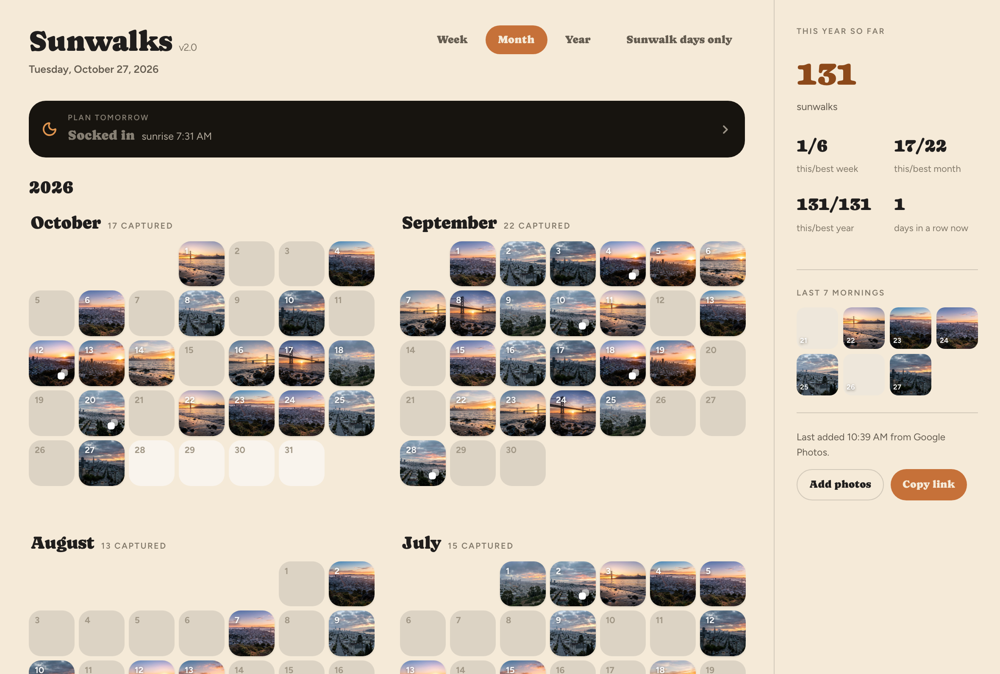
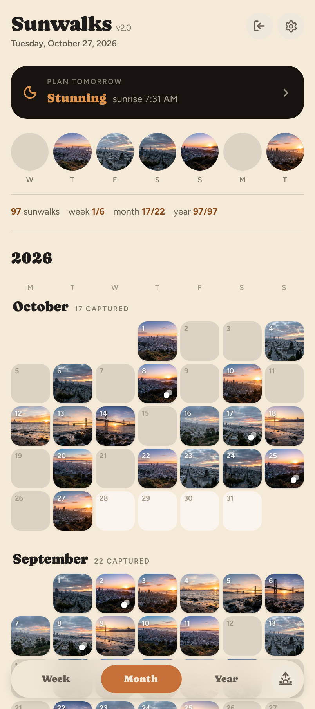
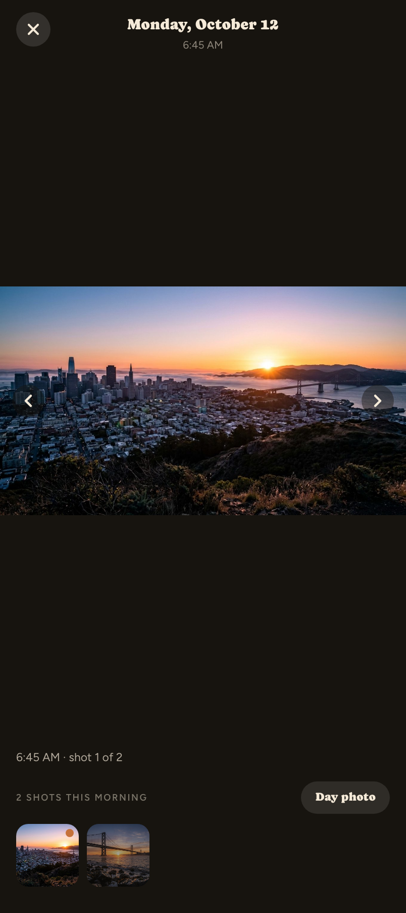
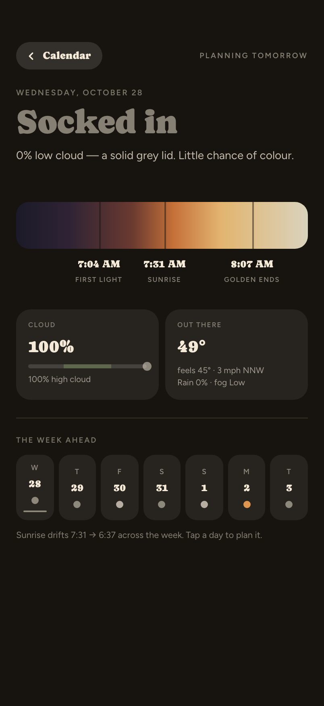
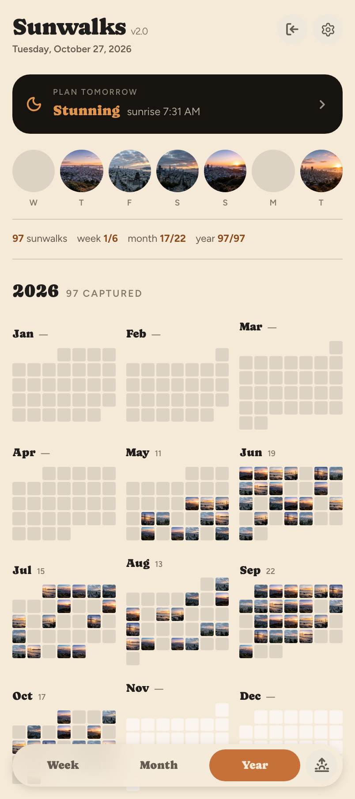

# Sunwalks

A personal calendar where every day square is the sunrise photo you were out
for that morning. Photos come from Google Photos; days you didn't make it out
stay empty, so the calendar is the streak. At night, a planning view reads
tomorrow's forecast so you can plan your walk accordingly.

<p align="center">
  
</p>

<p align="center">
  
  
  
  
</p>

> Screenshots use the bundled sample photos in [demo mode](#quickstart-demo-mode-no-google-account).
> These are AI-generated stand-ins (see [Credits](#credits)), not real photos.

## Features

- **Week / Month / Year zoom** with animated transitions, a "sunwalk days
  only" filter that collapses empty days, and this/best stats for the week,
  month and year.
- **Photo view** with multi-shot mornings, a chosen "day photo",
  swipe-down to dismiss, and a landscape mode that unlocks rotation only while a photo
  is open.
- **Planning view** for tomorrow morning: first light, sunrise and end of golden
  hour (solar maths via `suncalc`), cloud layers and conditions from
  [Open-Meteo](https://open-meteo.com/), and a one-word verdict (*Stunning*,
  *Nice*, *Clear*, *Foggy*, *Wet*) with a week-ahead strip.
- **Unlisted share link.** Anyone with the URL gets a read-only, `noindex`
  copy of the calendar. You can revoke it or generate a new one.
- **Installable PWA**, tuned for Android/Chrome: safe-area insets, the
  hardware back button closes overlays, 48dp touch targets, and `?d=today`
  deep links.
- **Single owner by design.** One Google account signs in; everyone else sees
  only what the share link exposes.

## How it was built: Claude Design → Claude Code

The application code in this repo was written with
[Claude Code](https://claude.com/claude-code), working from design specs
produced in Claude Design. The git history is the build log; it covers
five days in August 2026.

| Step | What happened | Where to look |
| --- | --- | --- |
| Design | A Claude Design prototype plus a written handoff: layout, tokens, states and suggested architecture | [`design_handoff_sunrise_calendar/README.md`](design_handoff_sunrise_calendar/README.md) |
| One-shot build | The whole app, implemented from the handoff in a single pass | commit *"One shot implementation"* |
| Platform pass | Android/Pixel plumbing spec, then implementation | [`ANDROID_UPDATE.md`](design_handoff_sunrise_calendar/ANDROID_UPDATE.md) |
| Motion | Nine named motions with exact timings and curves, then implementation | [`MOTION.md`](design_handoff_sunrise_calendar/MOTION.md) and the interactive `Sunrise Motion (standalone).html` |
| Planning | Forecast screen and verdict rules, then implementation | [`PLANNING.md`](design_handoff_sunrise_calendar/PLANNING.md) |
| Rebrand | New icon set and the rename to Sunwalks | [`design_handoff_sunwalks_icon/`](design_handoff_sunwalks_icon/ICON.md) |

The real-world problems show up in the history too:

- **The Google Photos Library API shutdown.** It was retired mid-project; see
  [below](#google-photos-access) for the redesign it forced.
- **A storage migration.** Photos moved from local disk to Vercel Blob.
- **A multi-commit hunt for a shared-element animation "ghost".** It included
  a temporary on-screen debug panel, which was later removed.

## Stack

Next.js 16 (App Router) · React 19 · TypeScript · Drizzle ORM + Postgres
(Neon in production) · Vercel Blob (private store) for photo bytes ·
hand-rolled Google OAuth · Google Photos **Picker API** · Open-Meteo +
`suncalc` · Claude API (vision tagging) · CSS Modules, no UI framework.

## Architecture

```
 Google Photos Picker ──(owner picks)──▶ /api/picker/session/* ──▶ src/lib/ingest.ts
                                                                     │  480px square + 1600px full
                                                                     ▼
 Postgres (Drizzle) ◀── photo rows, days ──┘          Vercel Blob (private) ◀── image bytes
      │                                                    │
      ▼                                                    ▼
 /api/days, /api/stats, /api/day-keys          /api/photos/[id]/image (streams bytes)
      │                                                    │
      └──────────────▶ CalendarApp (client) ◀──────────────┘
                              ▲
 Open-Meteo + suncalc ──▶ /api/planning ──▶ PlanningView
```

- **Data model** (`src/db/schema.ts`):
  - `photos`: one row per imported shot, with the date and the time it was
    taken.
  - `days`: one row per date that has photos, plus the chosen day photo.
  - `owner_account`: the single owner and their encrypted Google refresh
    token.
  - `sessions` and `share_links`: sign-in sessions and unlisted share tokens.
  - `sync_log`: a record of each import.
  - `forecast_days`: a cache of fetched forecasts for the planning view.
  - `forecast_snapshots`: what the forecast said about each morning, kept
    per lead time (1 = the evening before), so it can later be compared
    with the sky the photo actually shows.
  - `photo_tags`: Claude's reading of each photo: the sky category it
    actually was, alt text, colours, drama, mood and a place suggestion.
  - `tagging_batches`: Message Batches in flight, so a re-run resumes them.
- **Photos go through one interface.** `src/lib/photo-source.ts` is the seam
  between the app and wherever photos live (Google Photos imports today,
  the phone itself on Android). See [docs/architecture.md](docs/architecture.md)
  for it and the rest of the Claude layer.
- **Auth**: Google OAuth is used only to identify the owner and to call the
  Picker API. `src/proxy.ts` redirects unauthenticated page loads to
  `/login`, and every owner API route re-checks the session in
  `requireOwner()`.
- **Sharing**: `/s/[token]` and `/api/s/[token]/*` are read-only mirrors of
  the owner APIs, gated by an active share token instead of a session.
- **Image URLs are capability URLs.** `/api/photos/[id]/image` is public so
  the share page can render photos; photo ids are long, unguessable Google
  media ids.
- **"Day" boundaries** are computed in `APP_TIMEZONE` (`src/lib/dates.ts`),
  not UTC, so a 6 AM photo lands on the right square.

## Quickstart (demo mode, no Google account)

Demo mode seeds about 130 days of captures from 12 bundled sample photos,
skips auth, and serves images from `public/seed-photos/`. With it you can
click through every screen without any credentials.

Requires Node 20.9+ and Postgres.

```bash
git clone https://github.com/aornelas/sunwalks.git && cd sunwalks
npm install
docker compose up -d          # or any local Postgres
cp .env.example .env          # defaults point at the compose database
```

Set `DEMO_MODE=true` in `.env`, then:

```bash
npm run db:push               # create the schema
npm run db:seed               # demo data (wipes the demo tables first)
npm run dev
```

Open http://localhost:3000.

To try vision tagging on the sample photos, add an `ANTHROPIC_API_KEY` to
`.env`, then:

```bash
npm run tag-photos -- --sync --limit 3   # a few photos, one request each
npm run tag-photos                       # the rest, as one Message Batch
npm run backfill-forecasts               # what the forecast said each morning
```

Both scripts are safe to re-run: photos already tagged with the current
prompt version, and mornings that already have a forecast, are skipped.
Tagging the ~115 sample photos as a batch costs about $1.

The sample photos are rebuilt with `npm run sample-photos -- <dir>`, which
crops and resizes any folder of 16:9 images and strips their metadata
(EXIF, GPS, XMP, IPTC). `npm run sample-photos -- --check` fails if any
committed image carries metadata.

> **Never set `DEMO_MODE=true` in production.** It disables the owner check
> on every route.
>
> **Env precedence gotcha.** `npm run db:seed` reads only `.env`, but
> `next dev` also loads `.env.local`, which wins. If you've run
> `vercel env pull`, `.env.local` may point the dev server at your production
> database. Keep demo settings in `.env` and delete or rename `.env.local`
> while demoing.

## Real setup (your own Google Photos)

### Google Photos access

The original design assumed the Photos **Library** API: point the app at an
album and sync it daily. Google
[removed that access](https://developers.google.com/photos/support/updates)
on 2025-03-31 (`photoslibrary.readonly`, `albums.list` and
`mediaItems.search` now return 403). The replacement **Picker API** is a
one-time, user-present selection flow, so:

- **No automatic sync.** Every import is you opening the picker ("Add
  photos"). It supports multi-select (up to 2000 items), so a first bulk
  import and later top-ups each take one pass. See
  `src/hooks/usePickerImport.ts` (create session → open picker → poll →
  import).
- **Photos are copied at import time.** A picked item's `baseUrl` expires
  after about an hour, so a square (480px) and a full (1600px) derivative are
  downloaded once and stored in a private Vercel Blob store
  (`src/lib/storage.ts`). After that they're served through
  `/api/photos/[id]/image`.

### Steps

1. **Google Cloud Console.**
   - Enable the **Google Photos Picker API**. Not the "Photos Library API";
     that's the retired one.
   - Create an OAuth client of type *Web application*.
   - Add `{SITE_URL}/api/auth/google/callback` as an authorized redirect URI.
   - On the consent screen, add the
     `https://www.googleapis.com/auth/photospicker.mediaitems.readonly`
     scope.
   - Use user type **External** and add yourself as a test user. Otherwise
     personal accounts get "Access blocked".
2. **Vercel Blob.** Create a Blob store and set `BLOB_READ_WRITE_TOKEN`.
3. **Fill in `.env`** (see below), keeping `DEMO_MODE=false`. Run
   `npm run db:push` and then `npm run dev`.
4. **Sign in and import.** Visit `/login`, sign in, then pick your sunrise
   photos on `/onboarding`.
5. **Lock the owner slot.** Set `OWNER_EMAIL` to your address so no other
   Google account can claim it.
6. **Mind the 7-day token expiry.** While the consent screen is in
   *Testing*, Google expires refresh tokens after 7 days, so you'll need to
   re-sign-in (Settings → Change). Publishing the app to *Production* ends
   that. A single-user app doesn't need Google's verification, though you'll
   see a one-time "unverified app" screen.

### Environment variables

| Variable | Required | Purpose |
| --- | --- | --- |
| `DATABASE_URL` | yes | Postgres connection string |
| `APP_SECRET` | yes | Passphrase for the AES-256 key that encrypts the stored Google refresh token (`openssl rand -base64 32`) |
| `GOOGLE_CLIENT_ID` / `GOOGLE_CLIENT_SECRET` | real mode | OAuth client from the steps above |
| `BLOB_READ_WRITE_TOKEN` | real mode | Vercel Blob store for imported photos |
| `SITE_URL` | yes | Public origin; used for the OAuth redirect and share links |
| `OWNER_EMAIL` | recommended | Restricts sign-in to this Google account |
| `APP_TIMEZONE` | no | IANA zone that defines a "day" (default `America/Los_Angeles`) |
| `OWNER_LAT` / `OWNER_LON` | no | Location for the planning forecast (defaults to San Francisco) |
| `DEMO_MODE` | no | `true` = seeded local preview, no auth |
| `ANTHROPIC_API_KEY` | for tagging | Claude API key used by `npm run tag-photos` |
| `TAGGING_MODEL` | no | Model for tagging (default `claude-opus-5-5`) |
| `CRON_SECRET` | production | Authenticates Vercel's call to the nightly forecast job |

### Deploying

The app runs on Vercel as-is:

1. Import the repo into Vercel.
2. Attach a Postgres database (e.g. Neon from the Vercel Marketplace) and a
   Blob store.
3. Set the variables above.
4. Run `npm run db:push` against the production `DATABASE_URL` once (and
   again after pulling a schema change).

`vercel.json` schedules `/api/cron/forecast` nightly at 03:00 UTC (8 PM
Pacific in summer), which records the evening-before forecast even on days
the app isn't opened.

## Project layout

```
src/app/                 routes: calendar, /login, /onboarding, /s/[token] share page
src/app/api/             auth, picker sessions + import, days/stats, planning,
                         share links, image proxy, /api/s/[token]/* read-only mirrors
src/components/calendar/ CalendarApp (state) + mobile/web shells, zoom views,
                         photo views, planning view, settings sheet
src/lib/                 dates + grid maths, Google OAuth/Picker client, ingest,
                         Blob storage, stats, weather + verdict rules, crypto, session
src/db/                  Drizzle schema
src/lib/photo-source.ts  the interface between the app and wherever photos live
src/lib/tagging.ts       vision tagging: schema, request, validation
prompts/                 versioned prompts (tag-photo/v1.md)
scripts/                 seed, tag-photos, backfill-forecasts, sample-photos
test/                    unit tests (`npm test`); the Claude API is mocked
design_handoff_*/        the Claude Design specs this was built from
```

## Known gaps

- **Places have to come from you.** The Picker API exposes no location
  data. Tagging suggests a place from visible landmarks, but only a place
  you've set appears in captions and the place filter; setting one in the
  app arrives with the walk log (roadmap).
- **No AVIF/WebP or Display P3.** Imported photos are the sRGB JPEGs Google
  serves; re-encoding on import isn't implemented.
- **No automatic sync.** This is a Google platform restriction (see above).
- **Built for one person in one place.** The verdict copy assumes coastal fog
  ("marine layer"), and the Android tuning targeted a Pixel 10 Pro XL.

## Roadmap

The next step turns the planning view from "is it worth going out?" into
"where should I walk?", and gives every kind of morning a good answer.

- **Walk planning that learns** (Claude API)
  - *Done:* a photo-source interface between the app and wherever photos
    live; vision tagging of each sunrise (colours, cloud type, alt text,
    which category the sky actually turned out to be, and a place suggestion
    from visible landmarks) with a Batch API backfill; and a record of what
    the forecast said each evening, backfilled from Open-Meteo's archive.
  - An evening recommendation of where to walk tomorrow, starting from
    these defaults and replacing them with what has worked for you:
    - *Stunning* or *Nice*: a high vantage point.
    - *Clear*: a short walk.
    - *Foggy*: a forest walk, for the "tree rain" as fog condenses on the
      leaves (or somewhere high enough to get above a shallow marine layer).
    - *Wet*: enjoy staying in bed!
  - Learning from every morning: how often each forecast came true (shown
    as a confidence), which spots worked for which sky, and what you tell it
    ("Telegraph Hill is perfect for Stunning days").
- **Telegram walk buddy**: the evening plan arrives as a message with
  tap-to-pick buttons for the suggested spots, and a morning photo plus a few
  words logs the walk and teaches the recommender.
- **Sunwalks in Claude** (MCP): an MCP server over the same tools, so Claude
  can plan a walk, log feedback or search the archive, with tomorrow's
  planning card rendered inside the conversation as an MCP App.
- **Native Android**: read sunrise photos straight from the device instead
  of importing them, plus home-screen widgets.

## Credits

The sample photos in `public/seed-photos/` and `design_handoff_sunrise_calendar/assets/`,
and the photos visible in the screenshots, were generated with Google's
Nano Banana (Gemini image model) as stand-ins for real sunrise photos. They
aren't covered by the MIT license; use them freely, no rights reserved.

## License

Code is [MIT](LICENSE). The generated sample photos are excluded; see
[Credits](#credits).
